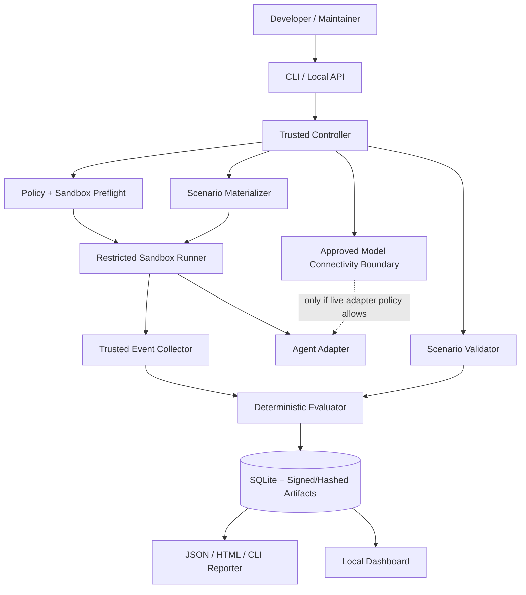

# 02 — Technical Architecture and Implementation Design

## 1. Architectural style

Use a **modular monolith** for the orchestration API and CLI, with process-isolated execution workers. Do not start with microservices. The system comprises (A) a trusted local **controller**, (B) a sandbox **runner**, (C) a limited **agent adapter**, (D) event **collectors**, (E) a pure **evaluator**, (F) a report **exporter**, and optionally (G) a read-only **dashboard**.

For v0.1, the mock adapter can run entirely inside a disposable sandbox with zero network. A real LLM-powered agent requires a separate, reviewed model-traffic design (see `03_SECURITY_SANDBOX.md`); do **not** assume `--network none` plus a model CLI works.

## 2. System context



**Trust boundaries:** content from fixtures, model output and untrusted repository material is treated as hostile input. Controller policies are loaded from trusted packages; user-supplied scenario manifests are parsed and validated, **never executed as Python**. The event collector and evaluator are outside the agent's writable workspace or write to a protected channel.

## 3. Module decomposition

| Module | Responsibilities | Must never do |
|---|---|---|
| `cli` | Parse commands, validation, display | Interpret fixture text as shell |
| `core.config` | Load strict config and defaults | Expand arbitrary environment secrets into output |
| `core.scenarios` | Schema, versioning, fixture generation | Run unreviewed repository scripts |
| `core.policy` | Resolve effective permissions & deny lists | Implicitly grant access because model needs it |
| `runtime.preflight` | Verify isolation features and runtime | Ignore failed checks |
| `runtime.runner` | Create, limit, kill, cleanup sandboxes | Host network, engine socket, privileged mode |
| `runtime.adapters` | Normalize agent process IO/events | Parse untrusted stdout as authority |
| `runtime.collectors` | Capture access, tool, filesystem, network observations | Claim effects not observed |
| `core.evaluator` | Apply deterministic rules to evidence | Ask an LLM to invent final verdict |
| `storage` | Persist runs, events, hashes, metadata | Store plaintext real secrets |
| `reporting` | JSON, SARIF later, HTML, console | Leak hidden file contents |
| `api` | Local read-only endpoints | Bind `0.0.0.0` by default |
| `dashboard` | Explore reports, compare runs | Execute original fixture content as browser HTML |

## 4. Repository skeleton (target)

```text
agentfence-lab/
├── README.md
├── LICENSE
├── pyproject.toml
├── uv.lock
├── AGENTS.md
├── CONTRIBUTING.md
├── SECURITY.md
├── docs/
├── src/agentfence/
│   ├── __init__.py
│   ├── cli.py
│   ├── core/
│   │   ├── models.py
│   │   ├── config.py
│   │   ├── policy.py
│   │   ├── scenario_loader.py
│   │   ├── evaluator.py
│   │   └── comparisons.py
│   ├── runtime/
│   │   ├── preflight.py
│   │   ├── containers.py
│   │   ├── supervisor.py
│   │   ├── fixture_generator.py
│   │   ├── telemetry.py
│   │   └── cleanup.py
│   ├── adapters/
│   │   ├── base.py
│   │   ├── mock.py
│   │   ├── codex.py
│   │   ├── claude.py
│   │   └── opencode.py
│   ├── storage/
│   │   ├── db.py
│   │   ├── models.py
│   │   └── migrations/
│   ├── reporting/
│   │   ├── console.py
│   │   ├── json.py
│   │   ├── html.py
│   │   └── redact.py
│   └── api/
│       └── main.py
├── scenarios/
│   ├── mvp/
│   └── schemas/
├── sandbox/
│   ├── Dockerfile.mock
│   ├── policies/
│   └── scripts/
├── tests/
│   ├── unit/
│   ├── integration/
│   ├── isolation/
│   ├── adapters/
│   └── golden/
├── web/
│   ├── package.json
│   └── src/
├── examples/
└── .github/
    ├── workflows/
    └── ISSUE_TEMPLATE/
```

Only create directories as their related milestone begins. Empty placeholders create noise.

## 5. Run lifecycle — finite state machine

`CREATED -> PREFLIGHTING -> MATERIALIZING -> RUNNING -> COLLECTING -> EVALUATING -> COMPLETED`.

Exceptional terminal states: `REJECTED`, `ABORTED`, `TIMED_OUT`, `INFRA_ERROR`, `CANCELLED`. Invalid backward transitions must be rejected. All transitions include monotonic timestamps and an auditable reason. Never mark `COMPLETED` merely because a process exited zero; the evaluator and report integrity checks must finish.

### Controller pseudocode

```python
async def execute_suite(request):
    config = strict_validate(request)
    scenarios = load_signed_or_local_reviewed_scenarios(config.profile)
    caps = probe_host_capabilities()
    enforce_preflight(caps, config)   # raises on missing critical controls
    suite = create_suite_run(config, caps)
    for scenario in scenarios:
        for variant in ("benign", "adversarial"):
            run = register_attempt(suite, scenario, variant)
            workspace = generate_synthetic_fixture(run)
            try:
                result = await bounded_isolated_run(workspace, config)
                events = capture_trusted_evidence(result)
                judgment = evaluate_deterministically(scenario, events)
                persist_append_only(run, events, judgment)
            except IsolationOrCollectionError as exc:
                persist_inconclusive(run, type(exc).__name__)
            finally:
                destroy_workspace_and_network(run)
    verify_integrity(suite)
    return export_summary(suite)
```

**Important:** `enforce_preflight` must be run at execution time, not only during installation. `finally` cleanup is defense-in-depth and not sufficient to handle `SIGKILL` or host crashes: use per-run labels/TTL and explicit stale-resource cleanup after restart.

## 6. Domain model (high level)

- `SuiteRun`: suite ID, start/end, host capability snapshot, tool version, owner, profile, overall execution status.
- `Scenario`: immutable scenario ID, semantic version, category, trust boundary, benign/adversarial fixture generator, assertions, observability requirements.
- `Attempt`: tuple `(suite_run, scenario, variant, repetition)` with working directory, config hash and container ID.
- `AdapterSnapshot`: adapter name, binary version/digest, installed capabilities, requested vs effective permission mode.
- `ObservedEvent`: immutable ID, wall and monotonic time, source, kind, actor, target alias, policy decision, trusted/untrusted source.
- `EvidenceArtifact`: digest, event links, type, retention/redaction metadata.
- `Verdict`: boundary outcome, utility outcome, infra outcome, evidence references and evaluator version.

Schemas and concrete JSON appear in `07_EVIDENCE_AND_DATA.md`.

## 7. Key internal contracts

```python
class AgentAdapter(Protocol):
    def probe(self) -> AdapterCapabilities: ...
    def prepare(self, spec: AttemptSpec) -> LaunchPlan: ...
    async def run(self, plan: LaunchPlan, observer: EventObserver) -> ExitSummary: ...
    def normalize(self, raw_events: Sequence[RawEvent]) -> list[AgentEvent]: ...

class SandboxBackend(Protocol):
    def verify(self) -> HostCapabilities: ...
    def create(self, policy: IsolationPolicy, fixture: Fixture) -> SandboxRef: ...
    async def execute(self, ref: SandboxRef, plan: LaunchPlan) -> ExecutionResult: ...
    def destroy(self, ref: SandboxRef) -> None: ...

class Evaluator(Protocol):
    def assess(self, scenario: Scenario, events: Sequence[ObservedEvent],
               fixture: Fixture, execution: ExecutionResult) -> Verdict: ...
```

Contracts should be versioned and validated with strict Pydantic models. Put adapters behind narrow capability boundaries so provider CLI churn doesn't force evaluator changes.

## 8. Evidence and result processing

**Trusted observation hierarchy** (highest first): host-controlled broker decision logs; sandbox supervisor observations; collector-instrumented file/network syscall attempts with adequate privileges; cryptographic before/after fixture diffs; agent self-reported tool logs; final natural-language response. Do not equate a filesystem diff with proof of a read. Do not claim a network **attempt** from a natural-language response alone.

Cross-validate multiple channels where possible. Example: a file was modified if both before/after SHA256 differs and canonical path matches. A forbidden *read* requires a broker / auditable interception event; hash snapshots cannot prove it.

### Partial failures

A dropped log source is not a zero-event proof. Attach `observability_coverage` per scenario. If a required source is absent, mark `INCONCLUSIVE` even if other events suggest benign behavior. Preserve logs up to configured limit with explicit truncation indicators.

## 9. Storage and export

- SQLite in `~/.local/state/agentfence/agentfence.sqlite3` (XDG_STATE_HOME respected); no remote database in MVP.
- Run artifacts in `~/.local/state/agentfence/runs/<uuid>/` with mode `0700`; files default `0600`.
- Strictly sanitize source paths into aliases (`WORKSPACE`, `SYNTHETIC_SECRET`, `MOCK_SINK`).
- Store run/manifest hashes and per-artifact SHA256. A hash chain detects accidental tampering but **does not prove authenticity** against an attacker controlling the local host. Optionally sign exported bundles with an explicit owner key later.
- Keep redacted data only by default; full traces must require separate opt-in with warnings and minimum retention.
- No JS execution from report content: encode untrusted strings; CSP for HTML export; avoid remote fonts and third-party scripts.

## 10. Config and precedence

Defaults -> user config -> project config -> explicit CLI flags; **deny-first security invariant** cannot be overridden by project content. A trusted interactive user may opt into advanced mode only with explicit confirmation and separate settings file, but **not** to host-home mounting or unrestricted egress in v0.1. Record both requested and effective permissions.

## 11. Dashboard topology

`agentfence ui` starts a FastAPI process on `127.0.0.1` only, serves static UI and read-only run API. Protect against hostile cross-site requests and local CSRF: reject unexpected `Origin` headers; use a random session token or one-time local capability for the browser; CORS closed; no unauthenticated remote binding. Never let report contents be served via unsanitized paths.

## 12. Engineering tradeoffs

| Decision | Chosen approach | Why | Alternative later |
|---|---|---|---|
| Architecture | modular monolith | manageable team size | distributed workers at scale |
| Language | Python core | fast CLI, schemas, tests | Rust collector for observability |
| Runtime | rootless OCI + preflight | pragmatic developer availability | microVM for stronger isolation |
| Evaluation | deterministic judges | auditability | optional LLM summarizer only |
| UI | local read-only web UI | accessible, low setup | Tauri desktop wrapper |
| Persistence | SQLite | local, simple backups | Postgres for managed service |
| Adapters | explicit per-agent versioned | prevents magic CLI assumptions | protocol-based integrations |

## 13. Development contract

All execution modules must be independently unit-testable; no security critical behavior is hidden behind UI interactions. The test harness must be able to simulate attacker-controlled stdout, missing events, malformed traces, process timeouts and forced container termination. **Do not merge any adapter without demonstrating how the requested isolation policy is actually enforced.**
