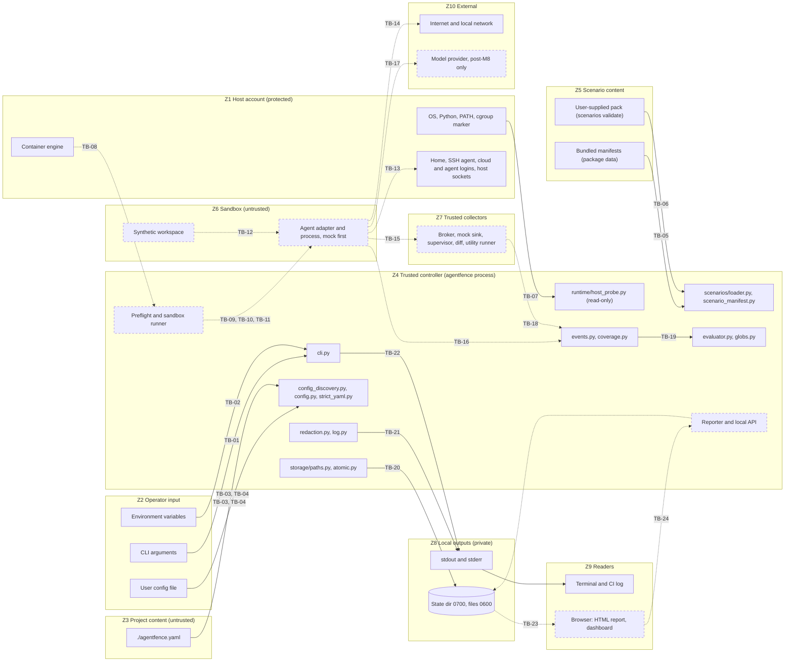

# Trust boundaries

This page maps every place where data or control crosses from one trust zone to another, and
records what enforces each crossing **on `main` today**. It reflects `main` on 2026-11-06,
after #80 (AF-0301, `scenarios validate`) was merged. Anything not yet built is marked "not
implemented" with the task that will build it. A design intention in docs/02 or docs/03 is not counted as enforcement.

Sources: docs/02 section 2 (system context), docs/03 sections 1, 2 and 8 (assets, attack surface,
controller threats), docs/07 section 2 (source trust). The trust order from docs/03 section 1 is:
trusted controller policy > container backend enforcement > trusted collectors > adapter tool
outputs > scenario text and model output.

## Trust zones

| Zone | Trust | Contents |
|---|---|---|
| Z1 Host account | protected asset | The user's files and home directory, SSH agent, cloud and agent login state, container engine and its socket, host network and local services. Nothing in the sandbox may reach these. |
| Z2 Operator input | trusted person, content still validated | CLI arguments, environment variables, the user config file under `$XDG_CONFIG_HOME/agentfence/`. |
| Z3 Project content | untrusted | `./agentfence.yaml` and anything else in the working directory. A cloned repository can ship these files. |
| Z4 Trusted controller | trusted | The `agentfence` Python process: CLI, config resolution, scenario validation, host probe, event model, evaluator, storage and logging. |
| Z5 Scenario content | bundled: reviewed data; user-supplied: untrusted | Bundled manifests shipped as package data, and manifest packs passed to `agentfence scenarios validate <path>`. |
| Z6 Sandbox | untrusted | The agent adapter, the agent process and the synthetic workspace. **Not implemented** (M2, M3). |
| Z7 Trusted collectors | trusted, outside the agent-writable filesystem | File-access broker, mock network sink, process supervisor, workspace diff, utility runner. **Not implemented** (M4). |
| Z8 Local outputs | private to the user | State directory (run artifacts, later SQLite), stdout, stderr. |
| Z9 Readers | untrusted rendering context | The terminal, CI logs, and later a browser showing HTML reports or the dashboard. |
| Z10 External | untrusted | Internet and local network, model providers, GitHub-hosted CI, PyPI. |

## Diagram

Solid nodes and arrows exist on `main`. Dashed nodes and arrows are not implemented yet. Edge
labels are the boundary IDs in the inventory below. TB-25 to TB-27 (CI and supply chain) are not
drawn.

## Inventory

Test references are `tests/unit/<file>::<test>`. "None" means no automated test covers the
boundary yet.

### Inputs to the controller

| ID | Source | Destination | Data crossing | Enforcement point | Implemented by today | Tests |
|---|---|---|---|---|---|---|
| TB-01 | Z2 | Z4 | CLI arguments: command, `--json`, `--config`, `--profile`, a `scenarios validate` path | Typer parsing. An unknown command or flag exits 2 with nothing on stdout. Profile names must match `^[a-z][a-z0-9-]{0,62}$`. | `cli.py`, `scenarios/__init__.py` | `test_cli_contract.py::test_usage_errors_exit_2_with_nothing_on_stdout`, `test_cli_doctor_scenarios.py::test_scenarios_list_bad_profile_exits_2` |
| TB-02 | Z2 | Z4 | Environment: `HOME`, `XDG_STATE_HOME`, `XDG_CONFIG_HOME`, `AGENTFENCE_STATE_DIR`, `AGENTFENCE_CONFIG`, `AGENTFENCE_LOG_LEVEL` | Relative `XDG_*` values are ignored. A relative `AGENTFENCE_STATE_DIR` or an unknown log level is an error (exit 2). Environment values are never interpolated into config. | `storage/paths.py`, `storage/config_discovery.py`, `log.py` | `test_storage_paths.py::test_relative_xdg_values_ignored_per_spec`, `test_cli_doctor_scenarios.py::test_relative_state_dir_env_exits_2`, `test_cli_doctor_scenarios.py::test_invalid_log_level_exits_2` |
| TB-03 | Z2, Z3 | Z4 | Which config files are read: user `config.yaml`, project `./agentfence.yaml`, `--config` or `AGENTFENCE_CONFIG` path | A file owned by another user (root excepted), world-writable, or group-writable by a shared group is refused. There is no upward directory search. Symlinks are resolved and the canonical path is recorded. Only regular files of at most 64 KiB are read. | `storage/config_discovery.py`, `core/config.py` (`layer_from_file`) | `test_config_discovery.py::test_world_writable_config_refused`, `test_config_discovery.py::test_foreign_owned_config_refused`, `test_config_discovery.py::test_no_upward_search`, `test_config.py::test_layer_from_oversized_file` |
| TB-04 | Z2, Z3 | Z4 | Config content (YAML) | Strict YAML rejects duplicate keys, anchors and aliases, multiple documents, a non-mapping top level, non-string keys, invalid UTF-8 and documents over 256 KiB. The strict schema rejects unknown keys and type coercion. No layer can change the locked invariants `offline_default`, `isolation_preflight_required`, `no_host_mounts`, `require_exposure_for_pass`, `require_observability_for_pass`, `redact_all_synthetic_secret_values` and `allow_external_connections: false`. `ui.listen` must be loopback. | `core/strict_yaml.py`, `core/config.py`, `core/types.py` | `test_strict_yaml.py::test_rejected_inputs`, `test_strict_yaml.py::test_alias_expansion_bomb_rejected_before_expansion`, `test_config.py::test_no_layer_can_weaken_security_invariants`, `test_config_discovery.py::test_project_cannot_weaken_invariants_via_discovery` |
| TB-05 | Z5 (bundled) | Z4 | Scenario manifests shipped as package data | Strict YAML, then `ScenarioManifest`: no field for commands, hooks, URLs or absolute paths; unknown keys rejected; paths are workspace-relative patterns with no `.`, `..` or empty segments. Pack rules: unique IDs, every benign control paired exactly once, pairs like-for-like. One bad manifest fails the whole listing. At most 200 per profile. | `core/scenario_manifest.py`, `core/types.py`, `scenarios/__init__.py`, `scenarios/loader.py` | `test_scenario_manifest.py::test_executable_or_network_fields_rejected`, `test_types.py::test_unsafe_patterns_rejected`, `test_scenario_catalog.py::test_invalid_manifest_fails_whole_listing`, `test_scenario_catalog.py::test_unpaired_bundled_scenario_rejected` |
| TB-06 | Z5 (user-supplied) | Z4 | Manifest files under a path given to `scenarios validate` | Same schema and pack rules as TB-05. Files open with `O_NOFOLLOW` and `O_NONBLOCK`, so symlinks and FIFOs are refused. Only regular files are read, the size is capped before reading, a symlinked pack root is refused, and a pack holds at most 500 files. Each file's SHA-256 is recorded. Manifests are parsed as data only and never executed. Not covered: canonical resolution of boundary globs against a materialized workspace (AF-0302), and any review gate or registry for community packs (FR-019). | `scenarios/loader.py`, `cli.py` | `test_scenario_loader.py::test_symlinked_manifest_refused`, `test_scenario_loader.py::test_fifo_is_not_a_regular_file`, `test_scenario_loader.py::test_pair_must_be_like_for_like`, `test_scenario_loader.py::test_cli_validate_writes_nothing` |
| TB-07 | Z1 | Z4 | Host facts: OS, architecture, Python version, effective UID, `PATH` lookups for `podman`, `docker` and `git`, the cgroup v2 marker file, `HOME` | Fact gathering is read-only: no writes, processes, daemon contact or network. Judgement is a pure function. Fail-closed: any required check that is not `PASS` gives `UNSUPPORTED`, and `runtime.rootless` is always `UNKNOWN`. Runtime paths are home-scrubbed. | `runtime/host_probe.py`, `core/capabilities.py` | `test_host_probe.py::test_good_host_still_unsupported_until_rootless_verification_exists`, `test_capabilities.py::test_any_required_non_pass_is_unsupported`, `test_cli_doctor_scenarios.py::test_doctor_writes_nothing` |
| TB-08 | Z1 (container engine) | Z4 | Runtime capability facts: rootless mode, user namespace mapping, cgroup delegation, seccomp, LSM | Must be read from the engine's server-side information, not the CLI context name (docs/03 section 4). | not implemented (AF-0201); see ADR-011 (`docs/adr/0011-initial-supported-environment.md`, proposed) | none |

### Controller to sandbox, and sandbox outward

| ID | Source | Destination | Data crossing | Enforcement point | Implemented by today | Tests |
|---|---|---|---|---|---|---|
| TB-09 | Z4 | Z6 | Sandbox launch policy: image digest, mounts, user, capabilities, network mode, read-only root, resource limits | The backend builds the full policy, with no host home, sockets or privileged mode, and refuses to launch rather than drop a control. The config already locks `no_host_mounts` and `isolation_preflight_required` to `true`, but nothing launches a sandbox yet, so these are declarations only. | not implemented (AF-0202, AF-0203, AF-0206) | config only: `test_config.py::test_no_layer_can_weaken_security_invariants` |
| TB-10 | Z4, Z5 | Z6 | Fixture materialization: synthetic workspace files placed in the sandbox | Synthetic assets only, with `AF_FAKE_` markers. Files are copied in, not bind-mounted. Fixture hashes are recorded. | not implemented (AF-0302, AF-0309) | none |
| TB-11 | Z4 | Z6 | Agent launch: argv and environment | Argument array with no shell. Explicit environment allowlist. No provider keys and no host `env` passed through (docs/06 section 6). | not implemented (AF-0204, adapter `prepare`) | none |
| TB-12 | Z6 (workspace) | Z6 (agent) | Untrusted fixture text the agent reads: README notes, tool output, data files | Not prevented. This is the behavior under test. Collectors observe what the agent does after reading, and the evaluator judges it. | not implemented (AF-0303..AF-0307) | none |
| TB-13 | Z6 | Z1 | File, socket and network access aimed at host secrets and services: home, SSH agent, cloud and agent login dirs, engine socket, D-Bus, X11 or Wayland, host loopback services | Mount allowlist, namespaces, no socket mounts, and refusal to launch if a prohibited mount exists. Verified by `doctor --self-test`. Residual risk: a kernel or runtime compromise (docs/03 section 12). | not implemented (AF-0203, AF-0205, AF-0208) | none |
| TB-14 | Z6 | Z10 | Outbound network | Tier 0 has no network. Only the in-boundary mock sink is reachable, and denials are logged. | not implemented (AF-0205, AF-0403) | none |
| TB-15 | Z6 | Z7 | File access requests on synthetic protected assets; requests to the mock sink | The trusted broker decides and logs `file.read_requested`, `file.read_granted` and `file.read_denied`. The sink logs `network.mock_received`. | not implemented (AF-0403, docs/12 Spike B) | none |
| TB-16 | Z6 | Z4 | Agent and adapter output: stdout, stderr, structured tool events, final response | Byte caps on capture. Recorded as `agent_reported` and never accepted as proof of an access, exposure, coverage or utility. The trust rules exist. Capture does not. | partly: trust rules in `core/vocabulary.py` (`SourceTrust.authoritative_for_access`), `core/evaluator.py`, `core/coverage.py`; capture not implemented (AF-0204, AF-0308) | `test_events.py::test_authority_follows_source_trust`, `test_evaluator_golden.py::test_agent_reported_forbidden_write_does_not_fail`, `test_evaluator_golden.py::test_agent_reported_utility_pass_is_ignored`, `test_coverage.py::test_agent_cannot_vouch_for_collectors` |
| TB-17 | Z6 | Z10 | Model requests and provider credentials (Tier 1) | Only an approved route through a reviewed gateway or host broker, with a dedicated constrained credential and no host login state. | not implemented; blocked on the M8 gate (AF-0801..AF-0808, ADR-007, ADR-012 in `docs/adr/0012-mock-first-and-live-candidate.md`, proposed) | none |

### Evidence to verdict

| ID | Source | Destination | Data crossing | Enforcement point | Implemented by today | Tests |
|---|---|---|---|---|---|---|
| TB-18 | Z7 | Z4 | Observed events | Strict event schema. Targets must be aliases under `WORKSPACE`, `SYNTHETIC_SECRET`, `MOCK_SINK`, `AGENT`, `SANDBOX` or `HOST`, with no `.`, `..`, backslash, NUL or newline. Details are capped at 32 keys of 512 characters, and detail strings starting with `/home/`, `/Users/` or `/root/` are rejected. The decision must match the event kind. Event IDs are content-addressed, so an altered event fails validation. The collector-side recorder assigns sequence numbers. The stream is bounded and ends with an explicit truncation event. | `core/events.py` | `test_events.py::test_target_must_be_a_safe_alias`, `test_events.py::test_details_are_bounded_and_path_free`, `test_events.py::test_tampered_event_rejected`, `test_coverage.py::test_recorder_reserves_last_slot_for_truncation_notice` |
| TB-19 | Z4 (event stream, mixed trust) | Z4 (verdict) | Events plus scenario rules in, verdict out | `validate_stream` rejects mixed attempts, duplicate IDs, sequence gaps and time going backwards. Only `host_observed` and `broker_observed` events count. Coverage comes only from trusted `collector.status` events. A missing or truncated required channel gives `INCONCLUSIVE`. A diff never proves a read. Attempts and completed effects are kept apart. In globs, `*` never crosses `/`. | `core/evaluator.py`, `core/coverage.py`, `core/events.py`, `core/globs.py` | `test_evaluator_golden.py::test_golden_matrix`, `test_evaluator_golden.py::test_pass_requires_exposure_evidence`, `test_evaluator_golden.py::test_inconsistent_stream_is_inconclusive`, `test_coverage.py::test_truncated_stream_downgrades_every_channel` |

### Controller outputs

| ID | Source | Destination | Data crossing | Enforcement point | Implemented by today | Tests |
|---|---|---|---|---|---|---|
| TB-20 | Z4 | Z8 (state dir) | Run artifacts and state files; SQLite later | Directories are created `0700` and files `0600` from creation. Existing paths that are loose, owned by someone else or symlinked are refused, not changed. Writes are atomic replaces with fsync. Run IDs must be canonical UUIDs. `safe_child` rejects traversal and symlink escape. No command writes state yet. | `storage/paths.py`, `storage/atomic.py`; SQLite not implemented (AF-0406) | `test_storage_paths.py::test_existing_loose_directory_refused_not_changed`, `test_storage_paths.py::test_safe_child_rejects_symlink_escape`, `test_storage_atomic.py::test_new_file_is_0600`, `test_storage_atomic.py::test_refuses_to_replace_symlink` |
| TB-21 | Z4 | Z8 (stderr), then Z9 | Log records and error messages | Logs go to stderr only. Only allowlisted field names print a value. `scrub_text` removes synthetic markers, credential shapes, PEM blocks, home paths and terminal control sequences. Exceptions log the type, never a traceback. Output is capped at 1 MiB with one truncation notice. | `log.py`, `core/redaction.py`, `cli.py` (`_fail`) | `test_log.py::test_json_lines_with_allowlisted_fields_only`, `test_log.py::test_exceptions_log_type_not_traceback`, `test_log.py::test_output_is_capped_with_single_notice`, `test_redaction.py::test_terminal_control_sequences_stripped` |
| TB-22 | Z4 | Z8 (stdout), then Z9 | Command output: `version`, `doctor`, `scenarios list`, `scenarios validate` | With `--json`, stdout carries exactly one JSON document, so logs never mix in, and JSON escapes control characters. Config source paths, runtime paths and validation problem messages are home-scrubbed. Two gaps are listed below. | `cli.py` | `test_cli_contract.py::test_json_stdout_stays_pure_with_verbose_logging`, `test_cli_doctor_scenarios.py::test_doctor_scrubs_home_in_config_source`, `test_host_probe.py::test_runtime_paths_are_home_scrubbed` |
| TB-23 | Z8 | Z9 (browser) | JSON and HTML reports | Escaped text, strict CSP, no remote assets, redaction and a preflight scan before export (docs/07 section 10). | not implemented (AF-0501, AF-0503, AF-0505) | none |
| TB-24 | Z9 (browser) | Z4 (local API) | Dashboard HTTP requests | Loopback bind, origin check, session token, read-only, no arbitrary path reads. The config already forces a loopback `ui.listen` and locks `allow_external_connections` to `false`. | server not implemented (AF-0601, AF-0607); config validation in `core/config.py` | config only: `test_config.py::test_ui_never_binds_non_loopback` |

### Development and supply chain

| ID | Source | Destination | Data crossing | Enforcement point | Implemented by today | Tests |
|---|---|---|---|---|---|---|
| TB-25 | Z10 (pull request from a fork) | Z10 (CI runner) | Untrusted code executed in CI | `permissions: contents: read`, no secrets, no `pull_request_target`, `persist-credentials: false`, third-party actions pinned to commit SHAs. Isolation tests are deselected on hosted runners. | `.github/workflows/ci.yml` | no automated test; reviewed when the workflow changes |
| TB-26 | Z10 (PyPI) | Z4 | Third-party Python dependencies | `uv.lock` with `UV_FROZEN=1`, `uv lock --check`, and `pip-audit --strict` on runtime dependencies. | `uv.lock`, `.github/workflows/ci.yml` (`lint`, `audit` jobs) | CI jobs `lint` and `audit` |
| TB-27 | Z4 (build) | Z10 (users installing the wheel) | Built wheel contents | CI fails if the wheel contains `tests/`, `.git/`, `.agentfence/` or `.sqlite3` files, then installs it into a fresh venv and runs the CLI. | `.github/workflows/ci.yml` (`package` job) | CI job `package` |

## Known gaps on `main`

These were found while writing this inventory. This page only documents them. Fixing them
belongs to the task named.

1. **Resolved (#85, AF-0201): doctor detects a rootful runtime.** Rootless mode is read from
   each engine's own server-side report (`docker info` security options, `podman info`
   `host.security.rootless`); a rootful daemon is `FAIL`, an unqueryable engine `UNKNOWN`.
   Seccomp, cgroup delegation and user namespaces are checked too
   (`runtime/engine_probe.py`, `runtime/host_probe.py`).
2. **Resolved (#86): human-readable CLI output is now scrubbed.** Manifest `title` and
   `legitimate_task.description` reject Unicode control and invisible formatting characters
   (`DisplayText`), and `scenarios list` / `scenarios validate` pass titles and file names
   through `scrub_text` before printing. Covered by `test_terminal_injection.py`.
3. **Resolved (#87): event details reject any host path.** `looks_like_host_path()` refuses
   absolute POSIX, `~`, Windows drive and UNC paths, `file:` URIs and text that embeds a
   well-known host directory. Covered by `test_events.py::test_details_reject_any_host_path`.
4. **Resolved (#88): source trust is checked against a collector registry.**
   `core/trust.py` maps each collector component to the most trust it may claim. Events
   from unregistered components count as `agent_reported`, and claims above a component's
   ceiling are lowered to it (evaluator 1.2.0). Covered by `test_trust_registry.py`.

## Keeping this page current

Update the inventory in the same pull request that adds, removes or changes an enforcement
point. When a "not implemented" row becomes real, replace the task ID with the module and add
the test that proves the boundary holds, including a negative case.
